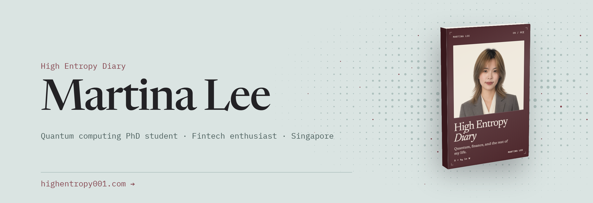

<a href="https://martinalee.me">
  <picture>
    <source media="(prefers-color-scheme: dark)" srcset="assets/banner-dark.png" />
    
  </picture>
</a>

  <a href="https://martinalee.me">Website</a> ·
  <a href="https://www.linkedin.com/in/martina-lee-zy/">LinkedIn</a>

These days I work on neutral-atom quantum computing for my PhD, in David Wilkowski’s group at Nanyang Technological University / [Centre for Quantum Technologies](https://www.cqt.sg/). Before that I spent a year on Singapore’s first homegrown superconducting quantum computer, a 20-qubit processor, working on machine-learning methods to improve qubit readout, and wrote an [open introduction to superconducting qubits](https://martinalee.me/research/superconducting-qubits/).

I’ve been into crypto since 2019, way before I studied physics. I like zero-knowledge proofs, options and trading, so I tend to build around markets and privacy.

### Things I’ve built

- [**Anneal**](https://martinalee.me/projects/anneal/) Mar–May 2026 An options DEX on Solana, built as a private OTC market: traders get competing quotes without revealing their budget.
- [**CrowdShift**](https://martinalee.me/projects/crowdshift/) Jul 2026 · solo A market that pays commuters to miss the crush: shift your trip off-peak and get paid once the shift is verified.
- [**Soliton**](https://martinalee.me/projects/soliton/) Jun 2026 · solo Verifiable memory for AI agents: each write gets a receipt on Sui, while the content is stored on Walrus.
- [**Agent Auction Protocol**](https://martinalee.me/projects/agent-auction-protocol/) Mar 2026 Private auctions for autonomous AI agents: a computing-resources marketplace with verifiable settlement.
- [**Superconducting qubits from scratch**](https://martinalee.me/research/superconducting-qubits/) Jun 2026 · open course Twelve chapters and twelve QuTiP labs I compiled after teaching PH3410 Quantum Hardware.

[All projects, demos and awards →](https://martinalee.me/projects/)

### Latest from the High Entropy Diary

<!-- BLOG-POST-LIST:START -->
- [My final-year project: steering a UV laser for trapped ions](https://martinalee.me/posts/final-year-project-trapped-ion-laser/) 26 Sep 2026
- [How you calibrate a qubit](https://martinalee.me/posts/how-you-calibrate-a-qubit/) 14 Jun 2026
- [Why on-chain options keep dying](https://martinalee.me/posts/why-on-chain-options-keep-dying/) 25 Apr 2026
- [Nine minutes to a private key, read from a qubit lab](https://martinalee.me/posts/quantum-attack-from-the-bench/) 24 Apr 2026
- [A proof can verify and still be wrong](https://martinalee.me/posts/a-proof-can-verify-and-still-be-wrong/) 29 Mar 2026
<!-- BLOG-POST-LIST:END -->

[All posts →](https://martinalee.me/posts/) · [RSS](https://martinalee.me/rss.xml)
